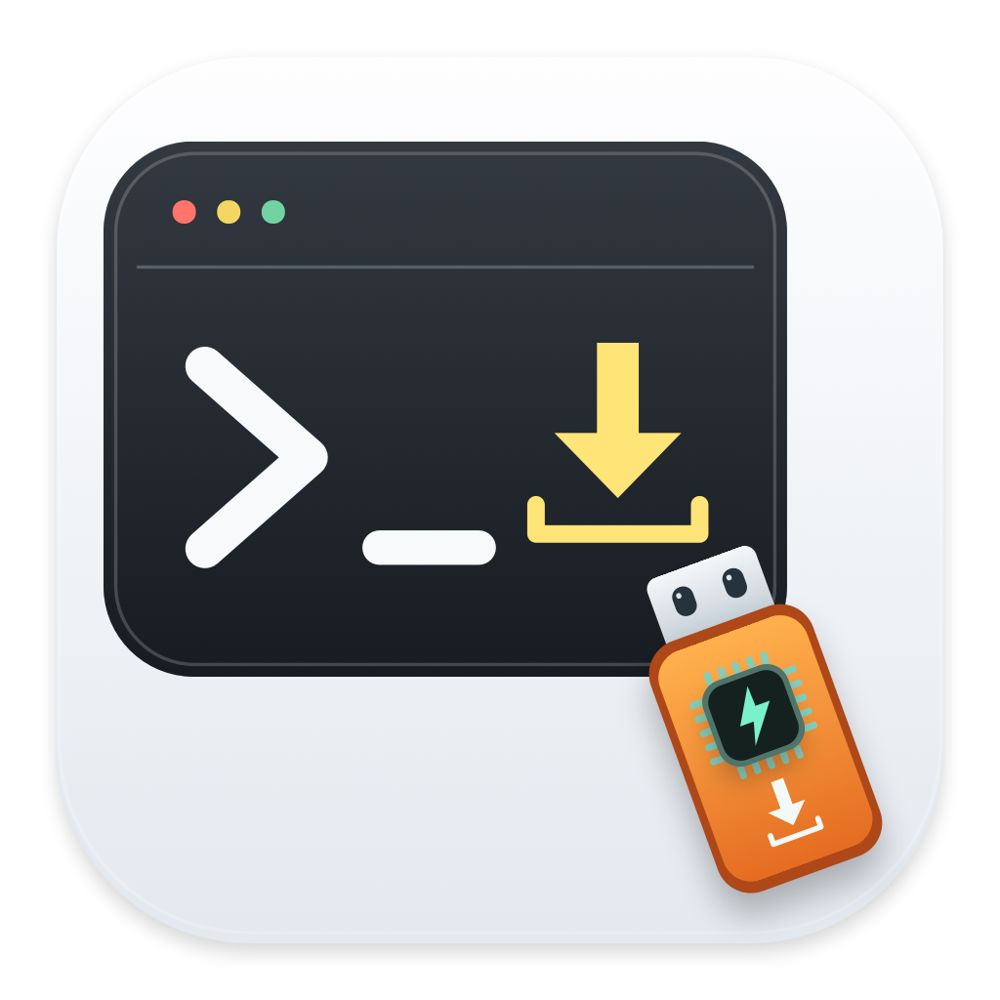

# SCMX-build work



**English** | [简体中文](README.zh-CN.md)

SCMX-build work is a macOS app for building and programming STM32 firmware. It also has a serial terminal, GDB debugging, and register inspection. The app is built with SwiftUI and AppKit. It runs on its own; you do not need Xcode.

## What you can do

The app runs tools installed on your Mac. It is intended for learning and working with one device at a time, not production programming.

- Generate and build CubeMX projects, then select ELF, HEX, or BIN artifacts for programming.
- Use OpenOCD with ST-Link or CMSIS-DAP, or STM32CubeProgrammer with ST-Link SWD, UART, or USB DFU.
- Review commands and firmware details before programming; reuse connection profiles without exporting local tool or project paths.
- Read Flash backups with length checks and overwrite protection; inspect option bytes without exposing security-changing controls.
- Debug through OpenOCD and ARM GDB, browse bundled vendor register definitions by MCU, and communicate through a text/HEX serial terminal.
- Switch the UI between English and Simplified Chinese using the language selector at the bottom of the left sidebar or in Tools settings. External tool logs may retain their original language.

## Installation

### Open a built app

Open `SCMX-build-work.app` in Finder. You need macOS 13 or later and a build for your Mac's architecture. You do not need Xcode, Apple Command Line Tools, or a Swift compiler to run the app. Install the STM32 tools for the operations you plan to use.

A new installation has no selected workspace, project, MCU, or firmware. Register definitions are bundled and can be browsed offline without a project or a connected board. Existing users keep their own saved selections after an update.

Repository collaborators can download the Apple Silicon build from the [private v0.3.0-beta.1 release](https://github.com/aili266/SCMX-build-work/releases/tag/v0.3.0-beta.1). There is no public app download yet. You can also build the app from source using the steps below.

The experimental Code Organization module is hidden in this beta. Its implementation and regression tests remain in the repository. Project import, CMake configuration, and project-directory normalization remain available.

### Build the app from source

To compile the app itself, install Apple Command Line Tools (`xcrun` / `swiftc`). You do not need the full Xcode IDE. Run these commands in the repository directory:

```sh
xcode-select --install
zsh build.command
open dist/SCMX-build-work.app
```

The build targets the current Mac architecture: arm64 on Apple Silicon or x86_64 on Intel. Only the Apple Silicon build has been locally validated; Intel is unverified. The preview uses an ad-hoc signature, not Developer ID signing or Apple notarization. Building from source does not require disabling macOS security globally.

### Install STM32 tools

STM32 firmware builds use ARM GCC, CMake, and Ninja. Use CubeMX to generate a project, OpenOCD or CubeProgrammer to program a device, and ARM GDB with OpenOCD to debug it. With Homebrew, you can install some of these tools with:

```sh
brew install cmake ninja open-ocd
```

Homebrew may need Apple Command Line Tools to install packages. The packaged app itself does not need them.

Install an `arm-none-eabi` GCC/GDB toolchain separately, matching your host architecture. Download [STM32CubeMX](https://www.st.com/en/development-tools/stm32cubemx.html) and [STM32CubeProgrammer](https://www.st.com/en/development-tools/stm32cubeprog.html) from ST when needed. **These external tools and ST firmware packages are not bundled or redistributed.** Their licenses apply independently.

Open the tools and firmware packages module and select the actual executables. For UART/DFU, select `STM32_Programmer_CLI`, not its installer or enclosing `.app`. Existing firmware can be programmed without CubeMX or HAL firmware packages; project generation requires CubeMX and the appropriate extracted package.

## Support and Validation Matrix

The following describes integration scope, not a certified board list. See the [recorded local validation](docs/VALIDATION.md) (Chinese) for evidence.

| Area | Current scope | Validation boundary |
| --- | --- | --- |
| macOS / architecture | macOS 13+; native host-architecture build | arm64 locally validated; x86_64 unverified |
| OpenOCD / SWD | ST-Link and CMSIS-DAP; programming, verification, reset, Bank 0 erase | Requires a supported target `.cfg`; no physical-board regression in this review |
| CubeProgrammer / SWD | ST-Link; device listing, programming, verification, full-chip erase, option-byte display | Command tests passed; actual CLI and target behavior remain unverified |
| CubeProgrammer / UART / USB DFU | ROM bootloader command integration | Requires chip-specific bootloader support; hardware testing pending |
| Flash backup | Address/length validation, size check, no overwrite | Automated safeguards tested; physical-device reads pending |
| Serial terminal | 8N1, text/HEX TX/RX, CRLF, counters, receive-data export | Real I/O tested with system pseudoterminals, not a physical UART adapter |
| Debugging / registers | OpenOCD + GDB; bundled, model-matched vendor SVD register definitions | Definition browsing is offline; reading live values requires a matching halted target. Shared vendor profiles can include optional blocks; this is not hardware certification |
| Projects / CMake | CubeMX, CMake, ARM GCC, VS Code configuration and project-directory normalization | Temporary CMake regressions passed; custom layouts need review. Experimental user-source organization is hidden |
| Automated checks | Programming and CMake checks, process safeguards, log delivery, localization, original self-test | Local checks and macOS 15 GitHub CI passed; see the validation record. Self-test requires local CubeMX/F1/G4 packages and runs locally only |

The MCU catalog combines bundled device-pack mappings with the local CubeMX database when available. The offline library contains 3,822 model/base-name entries across 30 families and 215 register profiles. A listed MCU is not necessarily tested or supported by the selected programming backend. Creating a project still requires that MCU's metadata and firmware package in CubeMX.

## Module Workflows

| Module | Typical use | Guide |
| --- | --- | --- |
| Programming workbench | Select the chip and connection, test it, then choose firmware and confirm | [Programming](docs/USER_GUIDE.en.md#5-program-firmware) |
| Backup / option bytes | Save a BIN backup; read option bytes over CubeProgrammer SWD | [Backup and option bytes](docs/USER_GUIDE.en.md#6-read-a-backup-or-option-bytes) |
| Serial terminal | Connect a port, send text or HEX bytes, save received data | [Serial terminal](docs/USER_GUIDE.en.md#7-use-the-serial-terminal) |
| Debugging | Load an ELF with debug symbols, pause, step, and inspect variables | [Debugging](docs/USER_GUIDE.en.md#8-debug-a-program) |
| Register assistant | Select an MCU and browse its definitions; connect and pause to read live values | [Register assistant](docs/USER_GUIDE.en.md#9-read-registers) |
| Projects and builds | Import or create a project, generate with CubeMX, and build | [Projects and builds](docs/USER_GUIDE.en.md#4-generate-and-build) |
| Tools, profiles and logs | Choose tools, reuse connection settings, reorder modules, save logs | [Tools, profiles and logs](docs/USER_GUIDE.en.md#11-profiles-logs-and-help) |

## Tests

```sh
zsh build.command
dist/SCMX-build-work.app/Contents/MacOS/STM32Studio --programming-test
dist/SCMX-build-work.app/Contents/MacOS/STM32Studio --settings-test
dist/SCMX-build-work.app/Contents/MacOS/STM32Studio --register-test
dist/SCMX-build-work.app/Contents/MacOS/STM32Studio --register-data-test
dist/SCMX-build-work.app/Contents/MacOS/STM32Studio --runner-test
dist/SCMX-build-work.app/Contents/MacOS/STM32Studio --log-test
dist/SCMX-build-work.app/Contents/MacOS/STM32Studio --localization-test
```

The bundle is named `SCMX-build-work.app`; its internal executable remains `STM32Studio`. The programming suite passed 137 assertions covering backend commands, addresses, firmware changes, profiles, serial I/O, CMake toolchain changes, and directory organization. Process and log tests also passed, including cancellation, timeouts, split UTF-8 characters, and repeated errors. Tests use temporary directories and do not program or erase connected boards. The process test compiles a small C fixture and needs Command Line Tools; normal app use does not.

Localization checks compare the English and Simplified Chinese key sets. They confirm string-key coverage, not exhaustive visual validation of every UI state.

The settings tests cover empty selections and preservation of saved paths. Register tests check device matching, payload integrity, access permissions, and read widths; the data test validates all bundled profiles. The isolated-home startup test is also included in the GitHub Actions workflow.

The original `--self-test` also passed in the recorded local environment. It checks the local CubeMX database and installed F1/G4 firmware packages, so it is not a prerequisite for a clean CI environment. Local success does not establish a successful GitHub Actions run.

## Limits and Safety

- No physical-board programming, erase, Flash read, option-byte read, or live GDB debugging was performed in this review. STM32CubeProgrammer CLI was not found locally; its real responses still need testing.
- OpenOCD erase affects **Bank 0 only**; CubeProgrammer erase uses **`-e all`**. Confirm the displayed scope before proceeding. Reads and verification may reset or halt the target; failures may leave it halted.
- UART and DFU are not supported by every STM32. Check the exact device's bootloader documentation and wiring. A serial terminal and programmer cannot share the same port.
- J-Link-specific integration, external Flash loaders, batch/multi-probe programming, SWO/RTT, CAN/I2C/SPI bootloaders, RDP changes, OTP programming, and security provisioning are outside this preview's scope.
- Dual-bank, multicore, TrustZone, and MP/Linux workflows are not certified. Complex custom CMake expressions and nonstandard project layouts may require manual changes.
- Debugging uses local port `3333`; close competing probe sessions. Register reads can have hardware side effects even though the UI provides no writes.
- The log window and its text export keep only the latest 150,000 to 180,000 UTF-16 units. Command return values keep at most the last 4 MiB. Save relevant errors before older output is discarded.

## Source Layout and Settings

| File | Responsibility |
| --- | --- |
| `App.swift` | Main window, projects, tool settings, background operations, logs |
| `Localization.swift` / `Resources/` | UI language selection and persistence, localized string lookup, English and Simplified Chinese string resources |
| `Engine.swift` | File organization, CubeMX/CMake workflow, basic OpenOCD commands |
| `ProcessRunner.swift` / `RunnerTests.swift` | Bounded process output, cancellation, timeouts and process-group regression tests |
| `LogView.swift` | Native text log display, bounded log delivery and log stress checks |
| `Programming.swift` / `ProgrammingView.swift` | Backend routing, validation, backups, profiles, programming UI |
| `SerialTerminal.swift` | macOS serial transport and terminal UI |
| `DebugSession.swift` / `RegisterCatalog.swift` / `RegisterDatabase.swift` | GDB/MI sessions, debug UI, model-matched register definitions and validated offline database |
| `DeviceCatalog.swift` / `FirmwareArtifact.swift` | CubeMX/device/package discovery; firmware metadata and SHA-256 |
| `Tests.swift` / `ProgrammingTests.swift` | Original environment-dependent tests and added portable regressions |

Settings are saved separately at `~/Library/Application Support/SCMXBuildWork/settings.json`, outside the app and source repository. A fresh installation does not import the former app's settings or automatically select a project. To clear this app's saved workspace and device choices, use **Tools & Firmware Packs → Clear Workspace and Device Selection**. Project files, tool paths, language, and sidebar order are kept. Exported connection profiles exclude tool, project, firmware and serial-port paths, and device serial numbers.

## Documentation and Help

- [English User Guide](docs/USER_GUIDE.en.md) / [中文使用说明](docs/USER_GUIDE.md)
- [English Troubleshooting and Support](docs/SUPPORT.en.md) / [中文故障排查](docs/SUPPORT.md)
- [Feature matrix and outstanding work](docs/FEATURE_MATRIX.md), [code review and residual risks](docs/BUG_REVIEW.md), [local validation](docs/VALIDATION.md), and [changelog](CHANGELOG.md) (Chinese)

Repository collaborators can report issues in the [private repository issue tracker](https://github.com/aili266/SCMX-build-work/issues). Include environment, tool versions, exact device, reproduction steps, and redacted logs. There is no public support service, response-time commitment, or comprehensive hardware certification.

## External Tools and License

The application invokes installed tools, including [OpenOCD](https://github.com/openocd-org/openocd), [STM32CubeProgrammer](https://www.st.com/en/development-tools/stm32cubeprog.html), [STM32CubeMX](https://www.st.com/en/development-tools/stm32cubemx.html), and the [Arm GNU Toolchain](https://developer.arm.com/Tools%20and%20Software/GNU%20Toolchain). These links do not imply endorsement or validated binary compatibility.

Original project code is licensed under the [MIT License](LICENSE). Use, modification, and redistribution require retaining the copyright and permission notice; the software is provided as-is, without warranty. Third-party tools and firmware packages retain their own license terms. MIT does not authorize redistribution of ST installers or other third-party material.

Bundled register data is derived from vendor SVD files and official device-pack mappings. Its sources, copyrights, licenses, and conversion notes are listed in [Third-Party Notices](THIRD_PARTY_NOTICES.md). The app's MIT license does not replace those data licenses.
