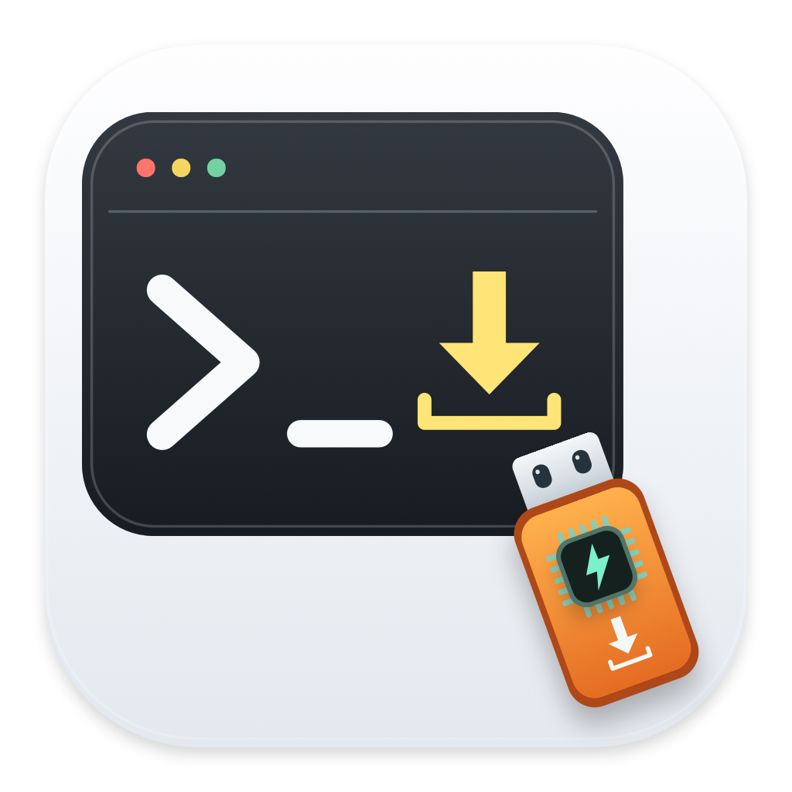

# SCMX-build work



[English](README.md) | **简体中文** | [使用说明](docs/USER_GUIDE.md)

SCMX-build work 是独立的 macOS App，用于编译和烧录 STM32，也能使用串口、调试程序和整理代码。**它不是 Xcode 扩展，运行时不需要 Xcode。**

## 打开 App

### 已有构建好的 App

1. 在 Finder 打开 `SCMX-build-work.app`。需要 macOS 13 或更新版本。
2. 在左侧底部或 Tools 设置中选择简体中文。
3. 看到主窗口后，按下一节选择工具。

运行打包 App **不需要 Xcode、Swift 编译器或 Apple Command Line Tools**。Apple Silicon 已做本机验证，Intel 尚未验证。当前包只有本地临时签名，没有 Developer ID 签名或 Apple 公证；不要为打开它全局关闭系统保护。

### 从源码构建 App

只有这一步需要 Apple Command Line Tools（`xcrun` / `swiftc`），不需要完整 Xcode。在仓库目录执行：

```sh
xcode-select --install
zsh build.command
open dist/SCMX-build-work.app
```

成功后，App 位于 `dist/SCMX-build-work.app`。构建默认使用当前 Mac 的架构。

## 第一次使用

新安装的工程、芯片和固件选择都为空。寄存器定义随 App 提供，选型号就能离线查看。更新 App 会保留你自己保存的选择。

| 步骤 | 点哪里、选什么 | 成功看到什么 | 失败先查什么 |
| --- | --- | --- | --- |
| 1. 选工具 | “工具与固件包”→“自动查找并检查” | 工具路径和版本 | 是否选了可执行文件 |
| 2. 导入工程 | 选总目录、芯片系列，再导入工程 | 工程列表和路径 | 总目录和 `.ioc` 位置 |
| 3. 编译 | 选工程→“生成工程”→“编译工程” | 生成的固件文件 | 错误提示、最早的编译错误 |
| 4. 烧录 | “烧录工作台”→选芯片、探针、固件→连接检测→烧录并校验 | 连接信息、校验结果 | 供电、接线、目标配置 |

已有 ELF、HEX 或 BIN 固件时，可以跳过导入和编译。完整步骤见[使用说明](docs/USER_GUIDE.md)。芯片列表不是实测支持清单。

## 需要安装哪些工具

| 操作 | 工具 |
| --- | --- |
| 编译 STM32 固件 | ARM GCC、CMake、Ninja |
| 生成工程 | CubeMX、对应的已解压固件包 |
| 用探针烧录 | OpenOCD；或 CubeProgrammer 配合 ST-Link |
| 串口、USB DFU 下载 | CubeProgrammer 的 `STM32_Programmer_CLI` |
| 调试 | OpenOCD、ARM GDB |

这些工具不随 App 打包。ARM GCC/GDB 选 `arm-none-eabi` 版本；CubeMX 和 CubeProgrammer 从 ST 官方安装。编译 STM32 不使用 Xcode 或 Swift。

使用 Homebrew 时，可以安装部分工具：

```sh
brew install cmake ninja open-ocd
```

Homebrew 可能要求 Command Line Tools 来安装软件包。这不是打包 App 的运行要求。只烧录已有固件，不需要 CubeMX 或固件包。

## 其他操作与注意事项

- **备份：**填地址和长度，读取到新 BIN 文件。先核对芯片内存范围，不覆盖已有文件。
- **串口：**选端口和波特率后连接，可发文字或 HEX 字节。接收只保留最近 64 KiB。串口下载前先断开终端。
- **调试、寄存器：**选择型号即可离线查看内置厂商寄存器定义，不必先建工程或连接开发板。读取实际值时再连接并暂停匹配的芯片；部分读取会清除标志。
- **整理工程目录：**先备份。只有 `.ioc`、尚未生成构建文件的工程会被拒绝，需先点“生成工程”。
- **整理代码：**先备份，再执行。遇到同名文件或目录冲突会中止；先检查报错路径，不要直接覆盖。
- **擦除：**OpenOCD 只擦 Bank 0；CubeProgrammer 使用 `-e all` 全部擦除。看清确认框再执行。
- **出错：**先看错误提示和日志。日志空白不代表成功。外部工具输出可能保留原语言。

UART、USB DFU 需要芯片支持对应的系统下载方式，不能任意接线。本轮未实测开发板烧录、擦除、备份和在线调试，CubeProgrammer 实际 CLI 行为也待验证。

暂不提供量产批量烧录、J-Link 专用界面、外部 Flash loader、SWO/RTT 或安全配置写入。多核、TrustZone、MP/Linux 和复杂自定义 CMake 工程需要单独检查。

## 测试记录

本地编译、日志与进程检查已通过，工程测试通过 137 项断言，中英文文字资源的键保持一致。实物烧录仍需逐块板验证；完整记录见[本地验证结果](docs/VALIDATION.md)。

```sh
dist/SCMX-build-work.app/Contents/MacOS/STM32Studio --programming-test
```

App 内部可执行文件仍叫 `STM32Studio`。回归使用临时工程和虚拟串口，不烧录或擦除开发板。原 self-test 需要本机 CubeMX 数据库和 F1/G4 固件包。本地通过不等于远端 CI 通过。

## 源码与设置

| 文件 | 用途 |
| --- | --- |
| App.swift | 窗口、工程、工具设置、日志 |
| Localization.swift / Resources/ | 语言选择、中英文字符串 |
| Engine.swift | 工程整理、生成、编译、工具运行 |
| ProcessRunner.swift / RunnerTests.swift | 外部命令、停止和超时、输出缓存及测试 |
| LogView.swift | 日志显示和重复错误测试 |
| Programming.swift / ProgrammingView.swift | 烧录、参数检查、备份和连接配置 |
| SerialTerminal.swift | 串口连接和收发 |
| DebugSession.swift / RegisterCatalog.swift / RegisterDatabase.swift | 调试、寄存器查询和离线定义库 |
| DeviceCatalog.swift / FirmwareArtifact.swift | 芯片与固件包列表、固件文件检查 |
| Tests.swift / ProgrammingTests.swift | 自动测试 |

设置保存在 `~/Library/Application Support/SCMXBuildWork/settings.json`，不在 App 包或源码仓库里。新安装的工程目录、工程、芯片和固件选择均为空，不自动读取旧 App 的配置，也不自动选择目录中的第一个工程。更新 App 会保留你自己已保存的选择。需要回到空白状态时，在“工具与固件包”点击“清空工程与芯片选择”；它不删除工程文件，并保留工具路径、语言和侧栏顺序。连接配置导出不含工具、工程、固件、串口路径或设备序列号。

寄存器数据来自厂商 SVD 和官方设备包的型号映射，按各自许可分发，详见[第三方声明](THIRD_PARTY_NOTICES.md)。多个型号可能共用同一份定义；可选外设和封装引脚仍需对照芯片手册，寄存器库覆盖不等于开发板实测。

## 帮助与许可

[中文使用说明](docs/USER_GUIDE.md) · [中文故障排查](docs/SUPPORT.md) · [English guide](docs/USER_GUIDE.en.md) · [English support](docs/SUPPORT.en.md)

[功能范围](docs/FEATURE_MATRIX.md)、[已知风险](docs/BUG_REVIEW.md)、[本地验证](docs/VALIDATION.md)和[更新记录](CHANGELOG.md)可供审阅。仓库成员可在私有 Issues 提交问题，请先删除日志中的路径、序列号和令牌。没有响应时间承诺或完整硬件认证。

原创代码采用 [MIT License](LICENSE)，可使用、修改和分发，须保留版权和许可声明；软件不提供担保。第三方工具和固件包保留各自许可，MIT 不授权重新分发 ST 安装包。

工具来源：[OpenOCD](https://github.com/openocd-org/openocd)、[CubeProgrammer](https://www.st.com/en/development-tools/stm32cubeprog.html)、[CubeMX](https://www.st.com/en/development-tools/stm32cubemx.html)、[Arm GNU Toolchain](https://developer.arm.com/Tools%20and%20Software/GNU%20Toolchain)。
